# Comic Planet!

**A pocket-sized 3D cartoon planet you can explore in your browser.** Tractors plough and harvest three farms, a steam train circles the globe over red arch bridges, planes take off from Comic Air, yachts sail between the islands, sheep trot home to their barns at night, and the zoo animals say hello when you poke them. Hop into anything and drive it yourself.

### ▶ [Play it now: shreyeahhs.github.io/comic-planet](https://shreyeahhs.github.io/comic-planet/)

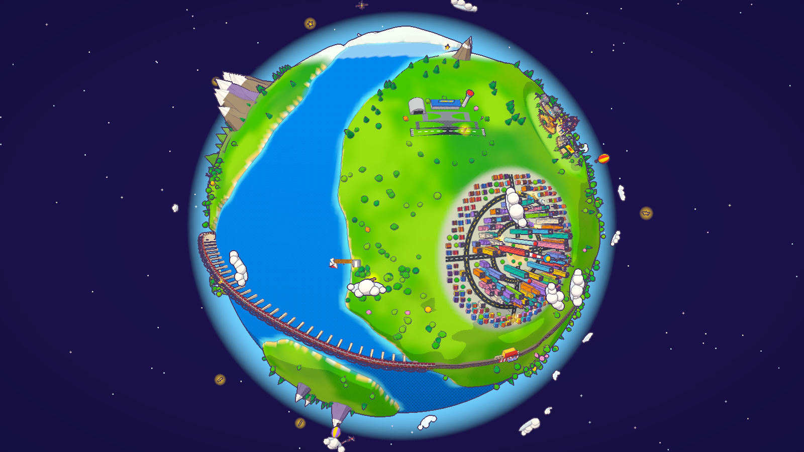

---

## 🤖 Built entirely by Claude

Every part of Comic Planet was written by **Claude** (Anthropic's AI model) working in Claude Code: the 3D world, the hand-built animals, the vehicle AI, the comic ink-and-halftone renderer, the sound engine, the start page, even the screenshots on this page. No human wrote a line of the code.

### Build it with a single prompt

Paste this prompt into Claude to build the whole planet in one go. The details will differ a little from run to run.

```text
Build "Comic Planet": one self-contained index.html (no build step; three.js from a CDN via an
import map, nothing else) that renders a small, explorable 3D cartoon planet in a comic-book style.

LOOK
- Toon shading, black ink outlines from screen-space edge detection (depth + normals), halftone
  dots in the shadows, a soft vignette. Comic fonts (Bangers + Comic Neue) and comic-panel UI with
  thick black borders and offset shadows.
- A planet about 10 units across: noise-shaped continents, beaches, snowy poles, forests, a snowy
  mountain range, palm islands, a lighthouse island with a sweeping beam, a smiling moon, drifting
  clouds, sparkling stars and an atmosphere glow. The sky turns blue as you zoom down to the surface.
- Merge static scenery into a few draw calls so it runs smoothly.

WORLD (build everything from primitives)
- City: colourful skyscrapers with window textures (windows glow at night), little houses, two
  ring roads with lanes and dashed lines, avenues, street lamps and a striped landmark tower.
- Zoo: fenced enclosures, a spinning Ferris wheel and hand-built rigged animals (giraffe,
  elephant, lion, zebra, penguin) with big cartoon eyes, walk cycles, wagging tails, flapping ears
  and flippers.
- Farmland: three farms (barn, silo, farmhouse, name sign) joined by dirt roads to a village
  crossroads, dozens of fields, windmills, a pasture with cows, and ten sheep that roam freely by
  day and walk back into their barn to sleep at night.
- An airport ("Comic Air") with runway, terminal, control tower, hangar and windsock, and a marina
  with a wooden pier on the coast nearest the city.
- A railway loop right around the planet that crosses the sea on red arch bridges with stone piers
  (high enough for yachts to sail under), with two stations: Comic Central and Farm Halt.
- Load the three.js example models Horse, Flamingo, Parrot and Stork from jsDelivr for horses
  galloping round the pasture and V-formation bird flocks. Keep working if they fail to load.

VEHICLES WITH JOBS (everything moves on the sphere's surface)
- Cars loop their ring-road lanes; a bus too.
- Tractors plough fields row by row (furrows appear behind them), crops grow over time (wheat,
  cabbages, pumpkins, sunflowers, lavender, carrots), then tractors return to harvest and drop hay
  bales, driving between farms along the dirt roads when the next job is elsewhere.
- Airliners park, taxi, take off, fly a sightseeing loop, approach and land. Two more planes cruise,
  one towing a "COMIC PLANET!" banner.
- Yachts sail looping sea routes (one calls at the marina). Hot-air balloons drift.
- A steam train (loco with smoking funnel, tender, three coaches, caboose) runs the loop and stops
  at both stations.
- Every vehicle can be ridden: click it or press 1–6 (plane, car, tractor, yacht, balloon, train).
  Chase camera plus near / far / cockpit views, WASD or arrow keys, turbo, cartoon jumps, plane
  barrel rolls, crashes with comic "BONK!" bubbles, speed lines, and a HUD showing speed, altitude,
  a star compass and the vehicle's paused job. When you hop off (Esc) the vehicle goes back to its
  job by itself. If an AI vehicle gets stuck, it teleports with a "POOF!".

PLAY
- Drag to orbit, altitude-aware zoom with wheel or pinch, double-click to swoop to a spot, and Esc
  always zooms back out to the whole planet.
- A start page: comic title burst, four feature cards, Sound / Comic ink / High quality toggles and
  a credits panel. It must never be cut off on short or narrow screens.
- A star hunt (26 stars in the sky, on roads, in fields, out at sea and on the railway), a day/night
  toggle, clickable windmills, Ferris wheel, lighthouse, clouds (they rain), Comic Tower (bells and
  confetti) and moon, a photo button, touch controls on phones. No fireworks.
- Shareable camera links: index.html#view=planet|city|zoo|farm|pasture|train|plane|tractor|yacht
  (&ui=1 keeps the HUD, &night=1 for night).

SOUND
- Real recordings from Wikimedia Commons (CC0, public domain, CC BY, CC BY-SA) for the animals,
  horns, steam whistle, ship siren, foghorn, engines and effects. Fetch them politely one at a time,
  trim each to its loudest moment, normalise loudness in the browser, use click-free fades, stereo
  panning and distance falloff, build engine loops from crossfaded grains, fall back to synthesised
  sounds when offline, and list every file, author and licence in the credits panel.
```

---

## 📸 Screenshots

All of these were rendered by Claude from the game itself, using its shareable `#view=` links, then checked and re-framed until they were the best shots it could get.

| | |
|:-:|:-:|
| 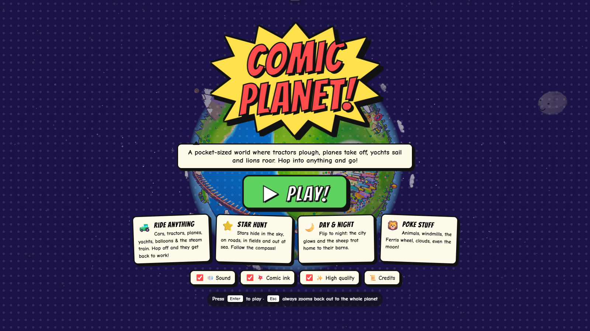 | 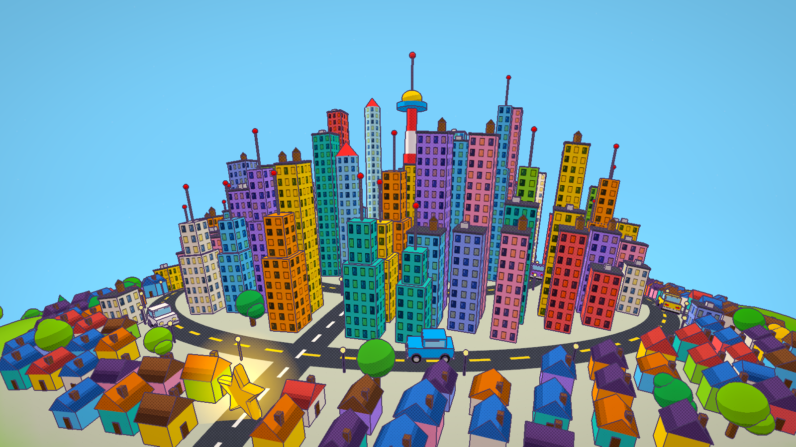 |
| **The start screen** | **The city by day** |
| 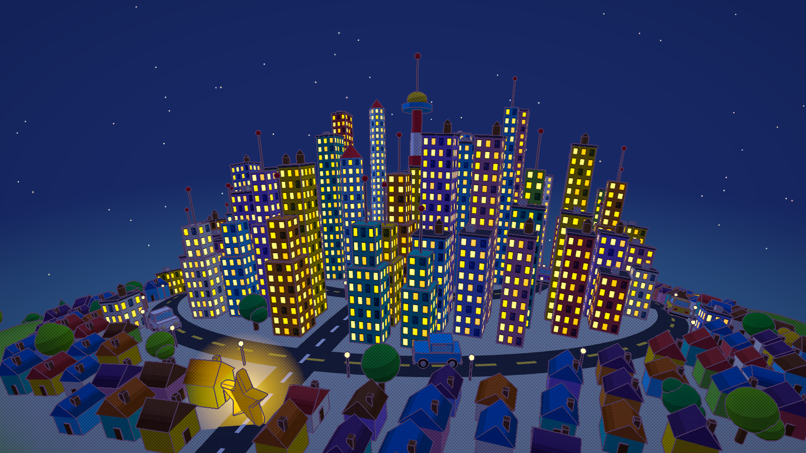 | 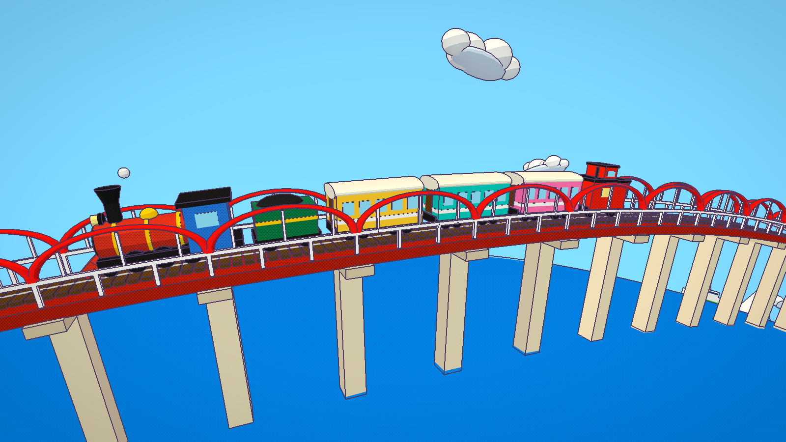 |
| **Flip to night and the city lights up** | **The Comic Express crossing a sea bridge** |
| 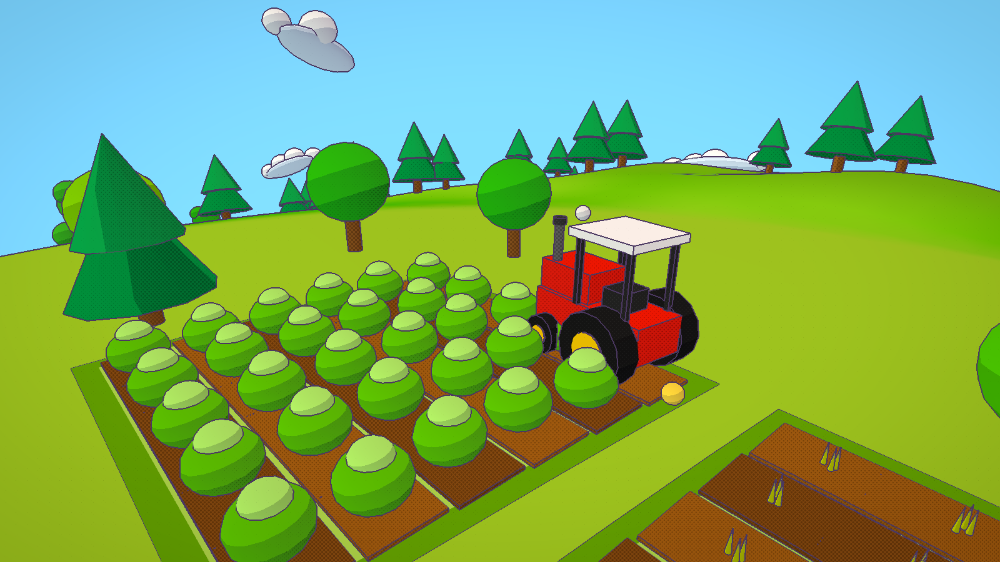 | 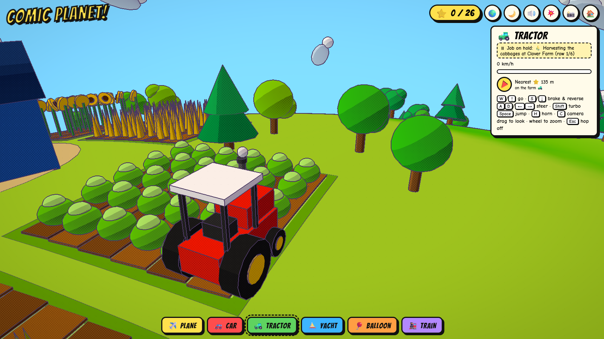 |
| **Tractors plough, wait for crops, then harvest** | **Ride anything; the HUD shows the job you interrupted** |
| 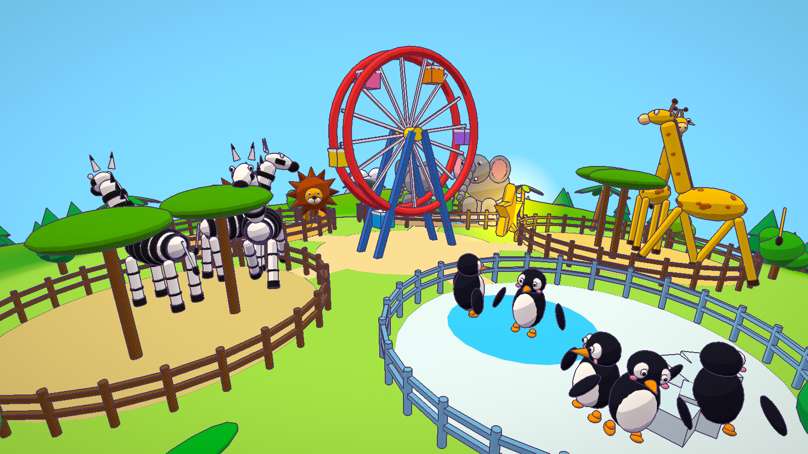 | 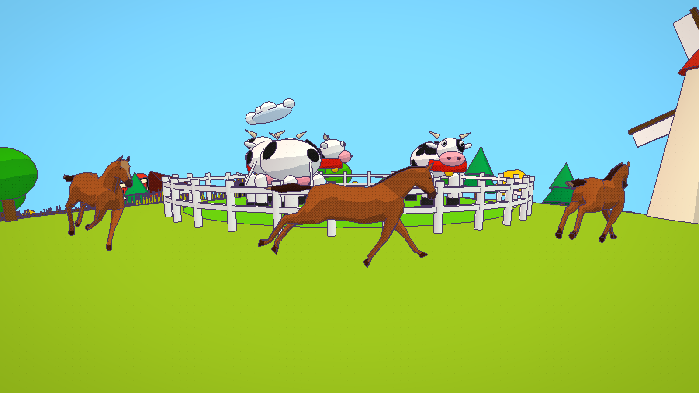 |
| **The zoo, with hand-built animals** | **Horses gallop round the cow pasture** |
| 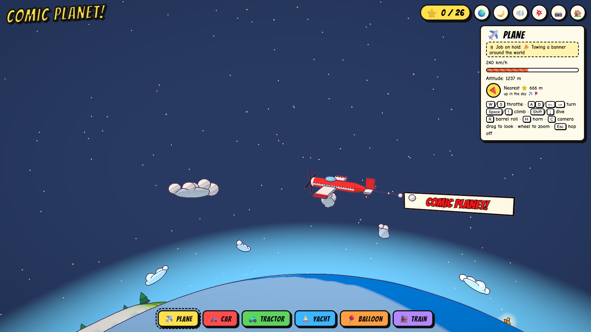 | 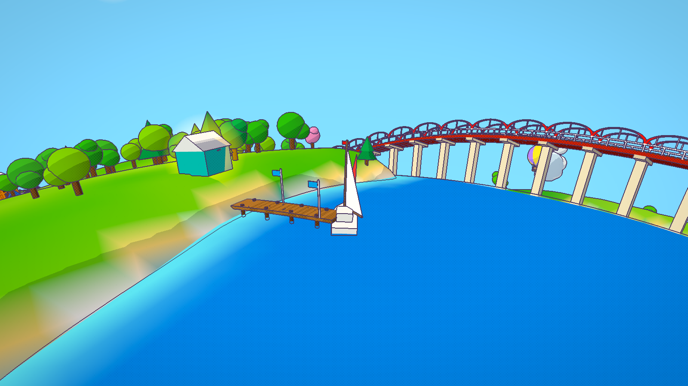 |
| **Towing the banner above the clouds** | **The marina, with the railway bridge across the bay** |

---

## 🎮 How to play

| | |
|---|---|
| **Look around** | Drag to orbit · scroll or pinch to zoom · double-click the ground to swoop in · **Esc** zooms back out |
| **Ride** | Click any vehicle, or press `1` plane · `2` car · `3` tractor · `4` yacht · `5` balloon · `6` train |
| **Drive / sail** | `W`/`S` or arrows · `A`/`D` steer · `Shift` turbo · `Space` jump · `H` horn |
| **Fly** | `W`/`S` throttle · `A`/`D` turn · `Space` climb · `Shift` dive · `R` barrel roll |
| **Camera** | `C` cycles chase / near / far / cockpit · drag to look around the vehicle |
| **Extras** | `N` day/night · `M` mute · `F` comic ink on/off · `P` photo · **Esc** hops off |

**Shareable views:** add `#view=planet`, `city`, `zoo`, `farm`, `pasture`, `train`, `plane`, `tractor` or `yacht` to the link, plus `&night=1` for night or `&ui=1` to keep the HUD. For example: [#view=train](https://shreyeahhs.github.io/comic-planet/#view=train).

## 🛠️ Under the hood

- **One file.** Everything is in `index.html`: no build step and no bundler. It needs an internet connection for three.js, the fonts, the four animated models and the sounds.
- **Rendering.** three.js with toon materials and a custom post-process pass: ink lines from depth and normal edges, plus halftone dots in the shadows. Static scenery is merged into a handful of draw calls.
- **A living world.** Every vehicle and animal moves on the curved surface and has a job it returns to after you ride it.
- **Sound.** Real recordings are streamed from Wikimedia Commons, auto-trimmed and loudness-levelled in the browser, with synthesised fallbacks.

## 🙏 Credits

- 3D engine: [three.js](https://threejs.org/).
- Animated horse, flamingo, parrot and stork models by mirada / ro.me, from the three.js examples.
- Sounds: recordings from [Wikimedia Commons](https://commons.wikimedia.org/), licensed CC0, public domain, CC BY and CC BY-SA. Every file, author and licence is listed in the game under **📜 Credits** on the start screen.
- Everything else was hand-built for Comic Planet by Claude.
